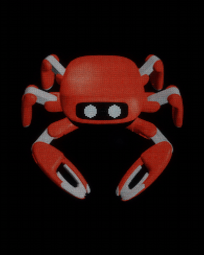
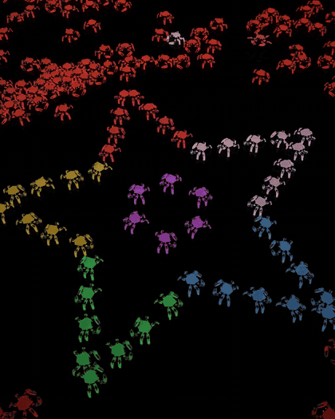
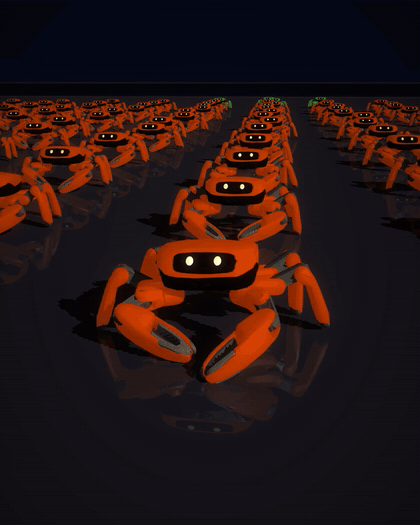
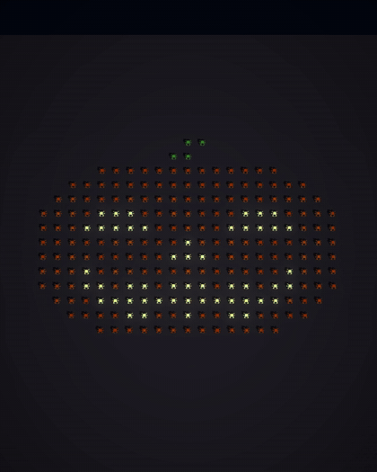

# crab

This is my entry for the [KingKong Crab Robot Open-source Challenge](https://beunlimited.me/en/events/crab-robot-challenge-2026).
Every crab in these videos is KingKong's open-source [Jumper](https://github.com/KingKongRobotics/jumper)
robot, simulated in MuJoCo and moved only by Jumper's own trained AI policies. Nothing is
hand-animated.

## The videos

### 1. "It's just one crab" (36 s, 11,904 crabs)

 

Music: an original 8-bit track I made with claude
[Download the MP4](https://github.com/shauryasen/crab/raw/deliverables/videos/09_hero_loop_4x5.mp4)

### 2. "Happy Halloween from 228 robot crabs" (32 s)

 

(The choreography for this one was written by hand as a plan file; the automatic prompt-to-plan step only covers simpler
requests like "make a heart, then spell HI".)

Music: I edited Bach's Toccata in D minor and Grieg's *In the Hall of the Mountain King* (both public
domain), with claude to add organs, bells and thunder sounds
[Download the MP4](https://github.com/shauryasen/crab/raw/deliverables/videos/05_halloween_4x5.mp4)

All the finished videos, including the earlier crab rave and a "how it works" cut, are in
the [`deliverables` branch](https://github.com/shauryasen/crab/tree/deliverables/videos).

## How it works

1. **A plan, written in bars of music.** Each video is a JSON file in `plans/` that says
   what happens on which beat: "form a heart at bar 12, jump at bar 14". The Halloween plan
   was made from the prompt by `crabshow/prompt.py`.
2. **Every crab gets its own physics sim.** `crabshow/runtime.py` loads the Jumper robot and
   its exported policies (`posture` for walking, `jump`, and the dance and gesture moves)
   and runs them in MuJoCo. Each crab is told only where to walk and which move to do. The
   policy works out how to move the legs.
3. **No collisions.** When crabs change formation, each one is matched to a spot so the paths
   never cross (Hungarian assignment). In the first vid a crowd simulation keeps them
   apart and makes sure everyone is back in place by the end.
4. **Rendering at scale.** 12,000 robots share a few meshes and are drawn as instances. The
   hero was simulated and rendered in parallel on about two dozen cloud machines, then
   stitched together.

## Layout

| | |
|---|---|
| `crabshow/runtime.py` | Standalone Jumper runtime. It reads the robot MJCF and each policy's `layout.json` contract, and re-implements the observation builder and actuator model in plain MuJoCo + onnxruntime. |
| `crabshow/formation.py` | Words and shapes to positions; collision-free assignment. |
| `crabshow/compose.py` | A choreography plan (JSON) to a timed score of moves and lights. |
| `crabshow/show.py` | Per-crab simulation of a score, in parallel. |
| `crabshow/render.py`, `video.py` | Composite render (shared low-poly meshes), bloom, typed prompt, captions, mux, segment join. |
| `crabshow/fx.py` | Show effects: an LED dance floor, lasers, light pillars, trails and confetti, all on the beat. |
| `crabshow/hud.py` | A "mission control" top-down view for "how it works" cuts. |
| `crabshow/prompt.py` | Prompt to plan for common phrasings ("make a heart, jump on the drop, spell HI"). |
| `crabshow/mosaic.py` | The giant crab: one crab rendered, downsampled, and a real crab placed on every pixel in that pixel's colour. |
| `crabshow/mob.py` | Crowd simulation for the hero video: thousands of crabs wander, dance and jump, a patch forms the star and heart, and everyone gets home on time. |
| `crabshow/crowd.py`, `lod.py` | Instanced rendering for ~12,000 crabs, with per-crab faces (happy, wink, sleepy, ...). |
| `crabshow/dense.py` | Memory-mapped trajectories for big swarms, smoothed between physics logs. |
| `crabshow/arrange.py` | Soundtracks: an original 8-bit track, and Bach and Grieg (public domain) arranged for synthesised organ, bells and thunder. |
| `crabshow/looks.py` | Film grain and other finishing looks. |
| `crabshow/terrain.py` | Dunes heightfield, shared by the physics and the render. |
| `plans/` | Example plans. |
| `SPARK.md` | Training brief for the GPU (tempo-robust dances). |

## Run it yourself

```bash
python3 -m venv .venv
.venv/bin/pip install mujoco onnxruntime numpy scipy librosa pillow matplotlib
scripts/fetch_jumper.sh                      # robot model + exported policies -> data/jumper
.venv/bin/python -I scripts/make_show.py plans/rave_v3.json --preview   # storyboard
.venv/bin/python -I scripts/make_show.py plans/rave_v3.json             # 1080x1350 video
.venv/bin/python -I scripts/plan_from_prompt.py "light up, make a heart, then spell YO" yo
```

Rendering uses software OpenGL (OSMesa) by default, so it runs on a headless CPU box.

## Credits

The robot model and policies are © KingKong Robotics, Apache-2.0 (fetched into `data/`,
not redistributed here). All music is synthesised in code (`crabshow/music.py`,
`crabshow/arrange.py`); the classical pieces are public domain.
I used Claude to help with writing code
